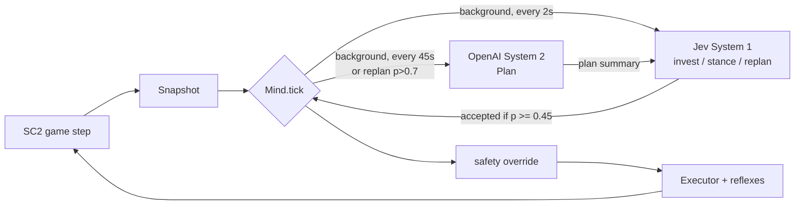

# sc2mind — Jev × OpenAI StarCraft II agent

A dual-process StarCraft II bot (Terran bio vs the built-in AI):

| Layer | Who | Cadence | Decides |
|---|---|---|---|
| **System 2** — reasoner | OpenAI model (`OPENAI_MODEL`, default `gpt-5`) via structured outputs | every ~45 game-s, or early when System 1 flags divergence | Strategy `Plan`: aggression, ordered investment priorities, marauder ratio, attack timing, worker target |
| **System 1** — reflex | [TypeSafe Jev](https://docs.typesafe.ai/) via `typesafe-sdk` | every ~2 game-s | Typed judgments: `invest` **Choice**, army `stance` **Choice**, `replan` **Noul** |
| **Code** | `executor.py`, `actions.py` | every game step | Legality, SCVs, depots, unit production, targeting, stim, safety override |



Design rules (from TypeSafe's "keep policy in code" guidance):

- **Code decides what is legal; models only choose.** Jev is only offered options whose prerequisites are met (`actions.legal_investments`, `legal_stances`).
- **Code owns thresholds.** Low-confidence answers keep the previous decision; a deterministic safety override forces `defend` when the base is threatened and we are outnumbered.
- **Never block the game loop.** Both models run as asyncio tasks; a late or failed answer means the last decision stands.
- **Everything is traced.** `runs/<stamp>/trace.jsonl` records every System 1 answer (with probabilities and request id) and every System 2 plan (with reasoning); a replay is saved next to it.

## Setup

1. Install StarCraft II (free Starter Edition via Battle.net) at the default location
   (`/Applications/StarCraft II` on macOS). On Linux, set `SC2PATH`.
2. Download the [ladder maps](https://github.com/Blizzard/s2client-proto#map-packs) into
   `StarCraft II/Maps/` (default map: `AcropolisLE`).
3. Install dependencies and set keys:

```bash
uv sync
cp .env.example .env   # fill TYPESAFE_API_KEY and OPENAI_API_KEY
```

## Run

```bash
uv run --env-file .env sc2mind --enemy zerg --difficulty Medium
uv run sc2mind --offline                 # rule-based stand-ins, no API calls
uv run sc2mind --map AcropolisLE --enemy random --difficulty Hard --no-realtime
```

`--no-realtime` lets the game step as fast as the bot does, so model answers land further
behind the game clock; realtime is the honest setting for latency.

## Test

```bash
uv run pytest
```

Tests cover legality, the safety override, and `Mind` scheduling/threshold policy with
fake models — no SC2 install or API keys required.

## Layout

```
src/sc2mind/
  state.py     Snapshot (pure data) + extraction from burnysc2 BotAI, enemy memory
  actions.py   Invest / Stance vocab, legality, safety override
  system1.py   JevReflex (Choice/Choice/Noul in one system_one call) + OfflineReflex
  system2.py   Plan schema, OpenAIReasoner (responses.parse) + OfflineReasoner
  mind.py      Non-blocking coordinator: cadence, thresholds, replan escalation
  executor.py  Orders + reflexes (depots, SCVs, production, army, stim)
  bot.py       burnysc2 BotAI wiring
  cli.py       `sc2mind` entry point
```

## Next steps

- Evaluate: label a set of snapshots, measure Jev's accuracy/abstention per question, and tune `S1_MIN_CONFIDENCE` on a held-out split.
- Win-rate harness across races/difficulties; compare against `--offline` as the baseline.
- Richer action space (medivacs, drops, multi-prong) and per-squad stance questions batched into one Jev call.
